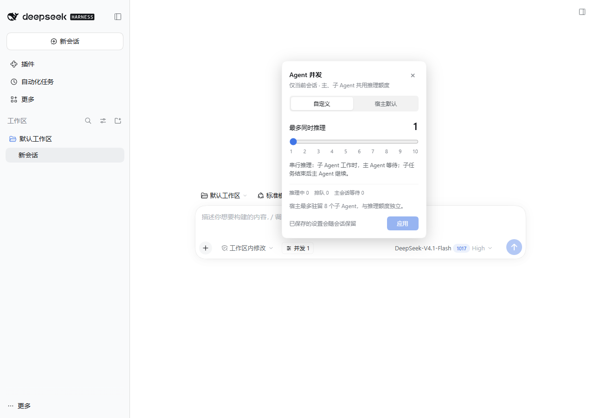

# DSH 会话并发 / Session Concurrency

[](https://github.com/MingoYung/dsh-session-concurrency/actions/workflows/ci.yml)

一个 **DeepSeek Harness 原生插件**：在输入框左侧加入小按钮，通过 **1–10 滑杆**为当前会话设置模型推理并发。主 Agent 与子孙 Agent 共用额度，其他主会话独立运行。

特别适合只能高效处理单路推理的本地模型：选 **1** 后，主 Agent 派发子任务即等待，子任务结束并送回结果后，主 Agent 才继续推理。等待由程序调度，不让主模型轮询子任务状态。



## 安装与使用

适配并实测：**DSH NEXT 2.0.21-next / DSH 内核 0.2.1-rc.4**。其他内核版本需要重新核对扩展接口。

1. 从 [Releases](https://github.com/MingoYung/dsh-session-concurrency/releases) 下载 `local-session-concurrency-0.1.0.tgz`，不需要解压。
2. 打开 DSH 的“插件 → 添加插件”，填入该文件的完整本地路径，安装并启用。
3. 按 DSH 提示刷新界面或重新加载插件。
4. 在发送会话第一条消息前，点击输入框左侧的“并发 默认”，选择“自定义”，调整滑杆并点击“应用”。

本地单路模型选 **1**；云端会话可以另选更高额度或保留“宿主默认”。子会话显示“并发 继承”，从主会话统一调整。

## 调度语义

额度 1 的执行顺序：

```text
主 Agent 分析并派发
       ↓
主 Agent 等待，不再请求模型
       ↓
子任务逐个推理并完成
       ↓
DSH 送回结果，恢复主 Agent
```

额度 **N** 表示本 DSH Host 最多同时运行 N 条模型推理流，包含主 Agent。超出额度的推理请求异步等待，普通工具和文件 IO 可以重叠。主→子→孙的嵌套派发共用根会话额度。

设置只在后台持久化成功后显示已应用；保存失败会保留原值并提示。切换会话时，迟到的旧请求不会覆盖新会话的按钮状态。设置重载后保留，子任务成功、失败、取消均会释放相应等待。

## 范围与边界

- 建议在发送首条消息前设置。运行中降低额度不会中断已开始的推理，新请求会等待存量降至上限以下。从默认切换为自定义时，会计入插件已经跟踪的活跃流。
- “宿主默认”移除该主会话的自定义额度，保留 DSH 原有调度方式。
- DSH 原生子 Agent **驻留容量**与模型推理并发独立，默认容量为 8；插件会读取和展示它，不修改全局设置。达到驻留容量时，DSH 仍可拒绝新的派发；本插件只排队已经获准执行的推理请求。
- 额度覆盖当前 DSH 进程的 `llm/stream` 路径，包括常用的本地模型和进程内 Spawn/Fork 子 Agent。外部 Codex、ACP 等在其他进程中自行发送的模型请求不在计数内；额度 1 仍可等待它们的 DSH 子任务结束事件。
- 两个主会话各设 1 仍可能合计请求同一个本地推理服务两次。跨会话共享模型端点的限流是另一项策略。
- 本插件不读取消息正文或模型密钥，也不依赖特定模型名判断是否启用。

会话设置保存于 `$DSH_HOME/plugins/session-concurrency/limits.json`，内容为会话 ID 和数字额度。禁用或卸载不会修改原生子 Agent 配置。卸载保留设置文件，便于重新安装后恢复。

## 开发和测试

使用 Node.js 24 与 npm：

```sh
npm ci
npm run build
npm test
npm pack
```

依赖锁定到实测 DSH **0.2.1-rc.4**。Cordis、Scope、Typert 等为宿主 Peer 依赖，开发测试安装固定的开发版本，插件安装时复用 DSH 自己的实例。浏览器包只将 React/ReactDOM 作为宿主共享模块，其余所需纯帮助代码包含在构建产物中。

集成测试使用真实 Cordis、AgentLoop、原生 Subagent、JSONL 持久化、Gateway 与 Client Remote，模型适配器为本地确定性实现，**不发送远端模型请求、不产生模型费用**。覆盖：

- 额度 1 的三子串行，父首次恢复请求包含完整子结果；额度 2 的峰值；独立会话和祖孙交接。
- 子失败、排队取消、默认行为和运行中的额度切换。
- 原生 RPC 的严格参数校验、会话权限和子会话继承边界。
- 并发保存、受控慢写、插件卸载/重载与 Gateway 派生接收者的共享更新队列。

CI 在 Ubuntu 与 Windows 上执行构建、测试和打包。真实 DSH 页面中的首条前设置、刷新保留、两个真实 Session 的设置隔离另有本地安装验收；截图来自空白隔离环境。没有把确定性测试模型的速度当作真实 Qwen tok/s 改善证据。

可选地设置 `DSH_TEST_RUNTIME`，让调试测试使用另一套包含 `node_modules` 的同版本 Runtime；普通开发与 CI 无需此变量。

## 反馈与许可

问题反馈：[GitHub Issues](https://github.com/MingoYung/dsh-session-concurrency/issues)。

代码采用 [MIT License](LICENSE)。浏览器包中的 Zod 和 DSH 纯帮助代码许可见 [THIRD_PARTY_NOTICES.md](THIRD_PARTY_NOTICES.md)。

实现接口的上游资料：[DSH 架构](https://github.com/deepseek-ai/deepseek-harness/blob/master/docs/architecture.md)、[Agent](https://github.com/deepseek-ai/deepseek-harness/blob/master/packages/core/agent/README.md)、[Subagent](https://github.com/deepseek-ai/deepseek-harness/blob/master/packages/subagent/subagent/README.md)。主分支可能变化，本插件以锁定并实测的内核版本为准。
